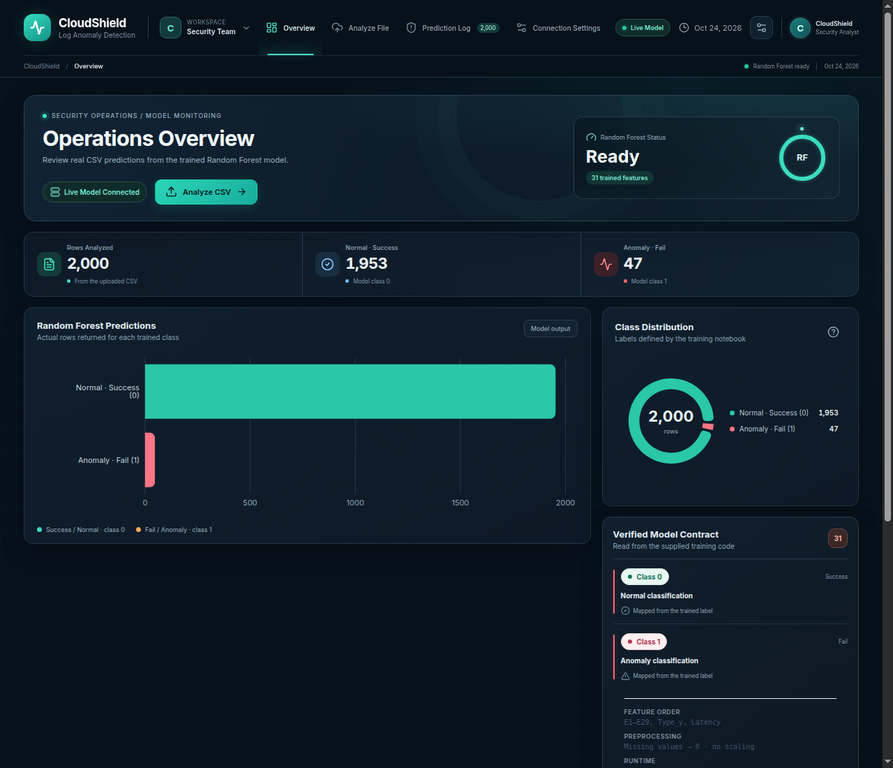
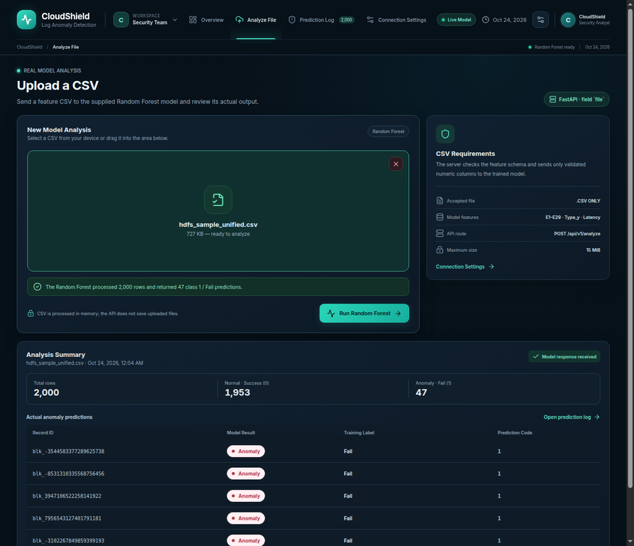
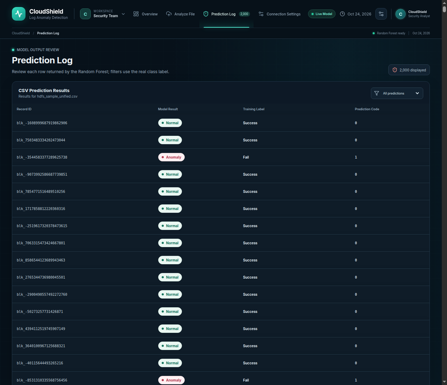
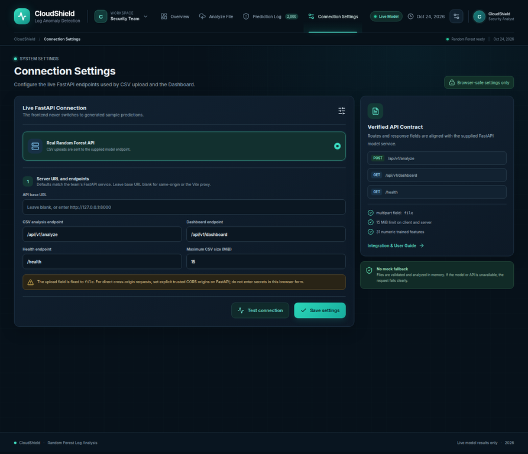

# CloudShield — User and API Integration Guide

## What this app does

CloudShield keeps the supplied React interface and sends CSVs to the team's actual FastAPI service. The service loads the supplied `rf_model.pkl`; there is no mock-prediction mode or silent fallback. The four screens are **Overview**, **Analyze File**, **Prediction Log**, and **Connection Settings**.

## Run locally

Requirements: Python 3.12, Node.js 22, and pnpm 11.25.0.

Start the API in terminal 1:

```bash
python3.12 -m venv .venv
source .venv/bin/activate
python -m pip install -r requirements-dev.txt
uvicorn main:app --host 127.0.0.1 --port 8000
```

Start the frontend in terminal 2:

```bash
pnpm install
pnpm dev
```

The Vite server serves the site on port `3000` and proxies `/api/*` and `/health` to FastAPI at `http://127.0.0.1:8000`. Leave **API base URL** blank for this same-origin proxy. For direct cross-origin requests, use the exact API origin and configure a trusted `CORS_ORIGINS` list on FastAPI. Do not use wildcard CORS.

## Analyze a CSV

1. Open **Analyze File**.
2. Select or drop a `.csv` file. Both the browser and server enforce a maximum of **15 MiB**.
3. The screen sends the file as `multipart/form-data` using the exact key `file` to `POST /api/v1/analyze`.
4. Wait for the server response. On success, the screen shows the actual row totals and model predictions, and the Overview/Prediction Log update in the current app session. On API, CSV, schema, or model errors, the app shows the error; it never inserts sample predictions.

A full test of the supplied sample can be run from the project root:

```bash
curl -F 'file=@ml/training/hdfs_sample_unified.csv' http://127.0.0.1:8000/api/v1/analyze
```

## Actual trained model contract

The original notebook and model artifact were inspected and exercised. `rf_model.pkl` loads as a 100-tree `RandomForestClassifier` under Python 3.12 and scikit-learn `1.6.1`. Its metadata reports 31 input features in this exact order:

```text
E1, E2, ... E29, Type_y, Latency
```

The backend ignores unrelated input columns, checks that all required feature names exist, reorders them to this order, rejects duplicate headers and nonnumeric nonblank values, and fills missing feature values with `0`. The notebook computes a scaled array in an earlier cell, but the shown final training code fits the saved forest with raw, unscaled `X`; this integration therefore does not add scaling.

Training class mapping:

| Model code | Notebook label | Interface label |
| --- | --- | --- |
| `0` | `Success` | `Normal` |
| `1` | `Fail` | `Anomaly` |

`BlockId` is not a model feature. When present, it is returned as `record_id`; otherwise the row number is used. The UI displays only values returned by the model/API. The API does not return confidence, severity, risk score, or an event timestamp, so those values are not fabricated.

## Endpoints and response

| Method and path | Purpose |
| --- | --- |
| `GET /health` | Returns `status`, `model_status`, `model_name`, `sklearn_version`, `feature_count`, and `class_mapping`; returns `503` if the model is not ready. |
| `GET /api/v1/dashboard` | Returns the current honest empty state (`has_analysis: false`, zero totals, empty `results`) plus loaded-model metadata. No server-side history is claimed or stored. |
| `POST /api/v1/analyze` | Accepts a CSV in multipart field `file`, runs the supplied model, and returns actual results and counts. |

Representative successful response shape:

```json
{
  "status": "success",
  "has_analysis": true,
  "file_name": "hdfs_sample_unified.csv",
  "analyzed_at": "<server-generated ISO-8601 time>",
  "total_records": 2000,
  "normal_count": 1953,
  "anomaly_count": 47,
  "results": [
    {
      "record_id": "blk_-1608999687919862906",
      "prediction": 0,
      "label": "Normal",
      "training_label": "Success"
    },
    {
      "record_id": "blk_-3544583377289625738",
      "prediction": 1,
      "label": "Anomaly",
      "training_label": "Fail"
    }
  ],
  "model_status": "ready",
  "model_name": "RandomForestClassifier",
  "sklearn_version": "1.6.1",
  "feature_count": 31,
  "class_mapping": {"0": "Success", "1": "Fail"}
}
```

The `2,000 / 1,953 / 47` values above are the actual predictions observed when the supplied 2,000-row CSV was submitted to the supplied model. They are **not** an accuracy score or a newly evaluated test-set metric.

## Connection Settings

Defaults:

| Setting | Value |
| --- | --- |
| API base URL | blank (same origin / Vite proxy) |
| CSV analysis endpoint | `/api/v1/analyze` |
| Dashboard endpoint | `/api/v1/dashboard` |
| Health endpoint | `/health` |
| Multipart field | `file` (fixed) |
| Maximum CSV size | `15 MiB` (fixed in the client and server) |

For a direct cross-origin frontend/API connection, configure an exact trusted origin in `CORS_ORIGINS` on the backend; the value must not be `*`. Production is designed to serve frontend and API from the same origin.

## Validation and failure behavior

- Non-CSV extension: `400`.
- Empty/unreadable CSV: `400`.
- File larger than 15 MiB: `413`.
- Missing model features, duplicate column names, or invalid numeric values: `422`.
- Missing/unloadable/incompatible model: service startup fails or endpoint returns `503`; no other estimator is substituted.
- Inference failure or invalid prediction vector: `500`.

The backend checks model type, the pinned scikit-learn version, all 31 feature names/order, and classes `(0, 1)` at startup. It processes uploads in memory and does not write the original CSV or persist predictions. The current UI retains the response while navigating during the same SPA session; a full page reload returns to the truthful empty dashboard. Durable history would require a separately designed and authorized storage feature.

## Test results

The supplied CSV was posted through the React/Vite same-origin proxy to the real FastAPI app. The API returned 2,000 rows: 1,953 `Normal/Success` and 47 `Anomaly/Fail`. The result vector was compared with a direct prediction call from the same loaded `rf_model.pkl`. The FastAPI test suite reports **9 passed**; its one warning is a Starlette/AnyIO deprecation warning, not a failed test. `pnpm build` is also part of the handoff checks. No accuracy claim is made.

## Screenshots from the real-model session









## Public access and data warning

If published, the current app has no user login or API token; anyone with the URL can submit CSVs up to 15 MiB. The endpoint is CORS-restricted but CORS is not authentication. Uploaded content and predictions are not durably stored, but files may contain sensitive information while being processed. Use the supplied sample or non-sensitive test data only unless authentication and privacy requirements are added.
